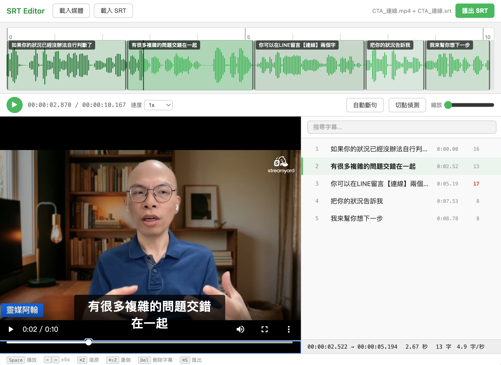

# SRT Editor

單檔 HTML 字幕時間軸編輯器。載入影片 + SRT，用波形圖拖拉調整字幕時間，匯出修正後的 SRT。

## 使用

- **線上版**：[john8895.github.io/srt-editor](https://john8895.github.io/srt-editor/)
- **離線版**：下載 `app-offline.html`，用瀏覽器打開即可，不需要網路

拖放影片和 SRT 檔案進去就能開始編輯。

> 🔒 所有處理都在瀏覽器本機完成，影片和字幕不會上傳到任何伺服器。

## 功能

- **波形圖編輯** — 拖拉、拉伸字幕區段調整時間軸
- **影片預覽** — 左側即時預覽，含字幕疊加顯示
- **時間尺標** — 獨立一排，點擊/拖動跳轉播放位置
- **磁吸對齊** — 字幕邊界自動吸附游標線、相鄰字幕、切點位置
- **切點偵測** — 分析音頻靜音區段，標記語音斷點
- **對齊聲音** — 一鍵把整份字幕重新對齊到語音：偵測語音段，用動態規劃把字幕依字數分配
  到語音段，段內按字數比例切時間。整體漂移與局部錯位一起修，保序不交叉，⌘Z 可復原
- **自動修正** — 把每條字幕的起訖各自吸附到 1 秒內最近的切點（局部微調用，大範圍漂移請用「對齊聲音」）
- **自動斷句** — 超過 16 字的字幕按台灣用語習慣自動拆分
- **新增字幕** — 在波形圖空白處拖拉建立新字幕
- **行內編輯** — 點擊文字直接修改，點時間碼改秒數
- **Enter 斷句** — 編輯中按 Enter 在游標處切成兩條
- **Delete 刪除** — 選取字幕後按 Delete 鍵刪除
- **字數提示** — 每行顯示字數，超過 16 字標紅
- **選取高亮** — 目前選取的字幕在波形圖上以深色標示
- **逐字高亮** — 播放時逐字標記當前位置（卡拉 OK 式）
- **搜尋取代** — 即時搜尋高亮 + 全部取代
- **變速播放** — 0.5x ~ 4x，Shift+>/<  快捷鍵，畫面顯示速度提示
- **自動縮放** — 長影片載入後自動調整波形圖縮放比例
- **復原/重做** — Cmd+Z / Cmd+Shift+Z

## 快捷鍵

| 按鍵 | 功能 |
|------|------|
| `Space` | 播放 / 暫停 |
| `← →` | 快退 / 快進 5 秒 |
| `Delete` | 刪除選取的字幕 |
| `⌘Z` | 復原 |
| `⌘⇧Z` | 重做 |
| `⌘S` | 匯出 SRT |
| `Shift+>` | 加速（0.5x ~ 4x） |
| `Shift+<` | 減速 |
| `Enter` | 編輯中斷句 |
| `Esc` | 關閉編輯 |

## 關於「對齊聲音」

Whisper 轉出來的 SRT，時間戳常常是機械切出來的等長區塊（例如整份都是 3.07 秒一格），
跟實際語音邊界對不上。「對齊聲音」處理的就是這種狀況。

它不是 forced alignment——純前端沒有 ASR 可以比對發音，靠的是「這段語音多長 ↔ 這幾條字幕幾個字」。
所以**字幕斷句本身錯掉的地方修不回來**（像「大家早安大／家好我是…」這種把詞切斷的），時間能對上，斷句還是錯的。

三場直播（46/28/35 分鐘，1048／640／808 條字幕）的實測結果：

| 指標 | 對齊前 → 後 |
|------|------------|
| 字幕時段內是語音的比例 | 64–68% → **73–79%** |
| 語音被字幕蓋到的比例 | 96–98% →  96–97%（維持） |
| 字幕交叉／時長不合法 | 0／0 |
| 耗時（46 分鐘音訊） | 0.16 秒 |

對已經對齊好的字幕再按一次不會有任何變動（冪等）。

## 技術

- [wavesurfer.js](https://wavesurfer.xyz/) v7 — 波形圖 + Regions + Timeline 插件
- 純前端，無需安裝、無需 build
- 支援音檔（mp3/wav/ogg/m4a）和影片（mp4/mov/webm）
- 介面設計參考 [WhatSub](https://whatsub.equal2.app/)

## 授權

MIT
